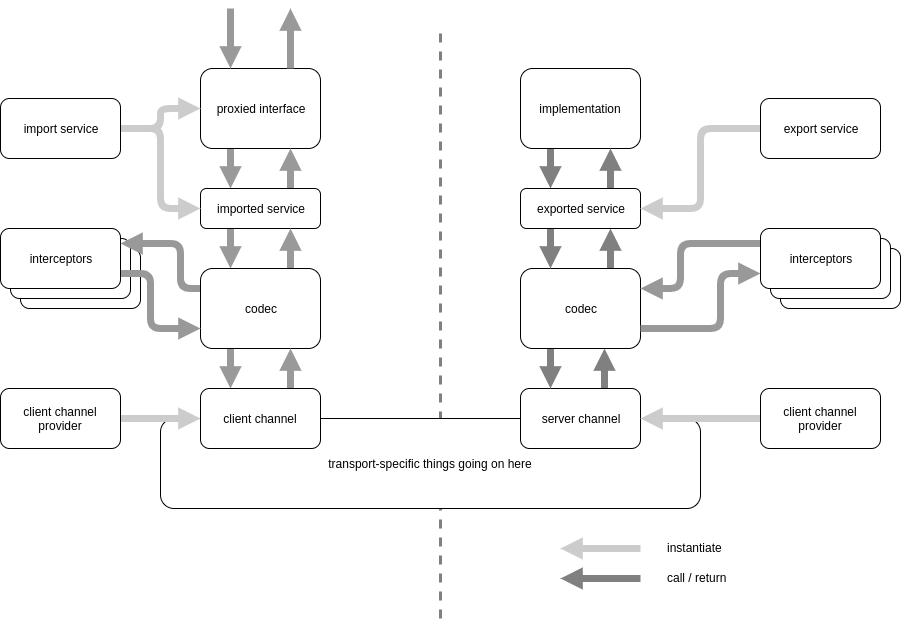

# Simple Remoting

this is a small library that performs a bit of spring magic to create proxies for interfaces, and makes them available for autowiring, then forwards these to a remote implementation. for transport, the only option currently available is rabbitMQ.

### Compatibility

- Java 25 or later.
- Spring Boot 3.5 and Spring Boot 4.0. This is one release for both lines.
- From 0.4.0 the codec uses Jackson 3 (`tools.jackson`), on both lines. The wire format is unchanged, so 0.2.2, 0.3.x and 0.4.0 services can talk to each other.
- For older setups (older JDKs, older Boot versions), stay on 0.2.x.

### Overview

-----

*currently, fields that will get a proxy for a remote service autowired have to be marked as `required = false`* 

-----

when this library is invoked, it will do two things when the application is starting: it will look for beans that are annotated to be exported (i.e. made available for remote calls), and it will look for interfaces that are annotated to be imported (i.e. have proxies created). The components that do this are called `RemotingExportService` and `RemotingImportService`.

These will be looking for concrete classes with `@RemotingEndpoint` (for export) and interfaces with  `@RemoteEndpoint` (for import). If an interface marked as `@RemoteEndpoint` already has an implementation available in the local context, it is skipped. Otherwise, for each of these interfaces a bean of scope prototype is created. This can then use instances of `RemotingCodec` and `ClientChannel` (acquired from a `ClientChannelProvider`) to map the method invocation to a `RemotingRequest` and from there to a byte array and send it out. On the other side, a `ServerChannel` (from a `ServerChannelProvider`) passes the request up through another `RemotingCodec` to an `ExportedService`.  

The details of message routing are up to the `ClientChannel` / `ServerChannel` implementation.




### Annotations

##### RemotingEndpoint and RemoteEndpoint

The two key annotations are RemotingEndpoint and RemoteEndpoint. These annotations control which interfaces are available for remoting.

@RemotingEndpoint marks an implementation bean as "exportable". It has to sepcify the corresponding interface, and that interface also has to be marked as @RemoteEndpoint. 

@RemoteEndpoint marks an interface as "importable". It has to specify an "app name" and a "service name", which can be used for routing messages. 

A simple remotable service looks like this:

**Interface RandomService**

```java
package com.mcg.tools.remoting.ex.server.api.services;

import com.mcg.tools.remoting.api.annotations.RemoteEndpoint;

@RemoteEndpoint(app="foo", name="bar")
public interface RandomService {

	public int getNumber();

	public void printSomething(String s);
	
}
```

**Implementation RandomServiceImpl**

```java
package com.mcg.tools.remoting.ex.server.impl.app;

import org.springframework.stereotype.Service;

import com.mcg.tools.remoting.api.annotations.RemotingEndpoint;
import com.mcg.tools.remoting.ex.server.api.services.RandomService;

@Service
@RemotingEndpoint(value=RandomService.class)
public class RandomServiceImpl implements RandomService {

	@Override
	public int getNumber() {
		return (int)(Math.random()*100d);
	}

	@Override
	public void printSomething(String s) {
		System.err.print(s);
	}

}
```

##### RemotingTimeout

This annotation can be placed on the method declaration on the interface, overriding the global timeout. Note that the default timeout is 10s, which can be overridden globally (see below for config options).

### Codec

The codec is responsible for serializing requests and responses from and to byte arrays suitable for sending over the wire. This is also used for mapping arguments to the actual method. 

The default codec uses its own Jackson 3 `JsonMapper` (`tools.jackson.databind`), created inside the codec. It reproduces the JSON of the Jackson 2 codec of 0.2.x/0.3.x exactly: dates and durations are written as ISO strings (not timestamps), `java.util.Date` with a `+00:00` offset, `Locale` as `de_DE`, enums by name, properties in declaration order; unknown properties and `null` for primitives are accepted when reading. The `ObjectMapper`/`JsonMapper` bean of the application and any `spring.jackson.*` properties are ignored, so that every service produces the same JSON no matter how it is configured or which Spring Boot version it runs on.

DTOs can still use the annotations from `com.fasterxml.jackson.annotation` (`@JsonIgnore`, `@JsonProperty`, `@JsonFormat`, ...), which Jackson 3 shares with Jackson 2. Annotations and classes from Jackson 2's `com.fasterxml.jackson.databind` (`@JsonSerialize`, `@JsonDeserialize`, `@JsonNaming`, custom `StdSerializer`s, `JsonNode`) are **not** seen by Jackson 3 and are silently ignored.

The wire format is fixed. It is tested against recorded JSON documents in `remoting-common/src/test/resources/wire/`: the older files were written by the 0.2.2 codec, the `*-more.json` files by the 0.3.x codec. Encoding has to reproduce them byte for byte, and decoding has to give the same values as a copy of the 0.3.x Jackson 2 codec kept in the tests (`Jackson2RemotingCodec`).

Known, unchanged since 0.2.x: arguments and return values are first read without their declared type, then converted. A `BigDecimal` therefore passes through a `double` and loses trailing zeros (`1234.50` arrives as `1234.5`), `Optional.empty()` arrives as `null`, and overloads with the same number of parameters are dispatched ambiguously.

There is one way to interfere with the object mapping in the codec.

**Override the Codec**

You can also change the codec behaviour by either extending it and overriding the `conform` method, or by implementing your own codec altogether. The basic contract is that a codec has to call all interceptors, and be able to convert from and to byte arrays. The exact way you end up doing this is up to you.

The replacement bean has to be marked `@Primary`, since the default codec is no longer conditional on a missing bean. The same applies to a custom `RemotingExecutor`.

---

```
note that if your interface takes interfaces as arguments OR returns interfaces as return values, you may have to add mappings to concrete classes for these.
```

---

### Interceptors

Interceptors can be used to add side-channel information. In most cases, this will be useful for adding and reading authentication information, so that the call on the remote environment is executed within the same authentication context. 

I frequently use this to pass along a JWT token with the remoting request, where I store the authentication token received from a client for example via HTTP in my security context, then, when perform remoting calls, I add this token as a header in the remoting request, and read it on the other side just like I would read an authentication header on an HTTP request.

### Timeouts

The timeout for a remote call is `mcg.remoting.timeout` (in seconds, default 10). A single method can override it with `@RemotingTimeout` on the interface. Calls are executed on a thread pool whose size is `mcg.remoting.poolsize` (default 8).

When a call times out, it is cancelled: the pool thread that was waiting for the reply is interrupted and freed, so calls to an unresponsive service cannot block the pool for other services. The caller sees an `UndeclaredThrowableException` whose cause is a `TimeoutException` (interface methods do not declare the exception, so the proxy wraps it). If the reply arrives after the call was cancelled, it is dropped and a warning (`unknown correlation id`) is logged.

### Logging

With `logging.level.com.mcg=DEBUG`, the library logs interface, method, argument count and duration of a call (for example `AInterface.add (2 args) took 3 ms`), but no argument or return values.

Full request and response bodies are only logged with `logging.level.com.mcg.tools.remoting.payload=TRACE`.

**Warning: the payload logger logs credentials (such as JWTs passed as arguments) and personal data. Do not enable it in production unless you can protect the logs.**

Exception messages from remote implementations are logged as they are; the library cannot know what a service puts into them.

### Build

```
mvn verify                              # Spring Boot 3.5 (default)
mvn -Dspringboot.version=4.0.9 verify   # Spring Boot 4
```

### Migrating from 0.3.x

- `remoting-common` depends on `tools.jackson.core:jackson-databind` (Jackson 3) instead of Jackson 2's `jackson-databind`, `jackson-datatype-jdk8`, `jackson-datatype-jsr310` and `jackson-module-parameter-names`. If your application used any of these only because remoting brought them in, declare them yourself.
- A codec subclass that overrides `conform` compiles against Jackson 3 types now.
- Nothing else: no API, annotation, configuration or wire-format change.

### Changes in 0.3.1

- AMQP server channels start consuming when the Spring context has been refreshed. Before, they started at the first connection check, about 5 s after startup, so a freshly started instance served no calls for those seconds.
- If a server channel fails to start consuming, the next connection check (every 10 s) retries it. Before, it stayed dead until the connection was replaced.

### Migrating from 0.2.x

- Java 25 is required.
- The codec and executor beans are no longer `@ConditionalOnMissingBean`. A replacement has to be marked `@Primary`, otherwise startup fails with a `NoUniqueBeanDefinitionException`.
- The application's `ObjectMapper` is no longer used by the codec (see Codec).
- Payload bodies are no longer logged at DEBUG; they moved to the `com.mcg.tools.remoting.payload` logger at TRACE (see Logging).

### Config Options

Here's a list of configuration options:

```
mcg.remoting:
  timeout: 10   [timeout, in seconds]
  poolsize: 8   [size of executor threadpool]
```

